<p align="center">
  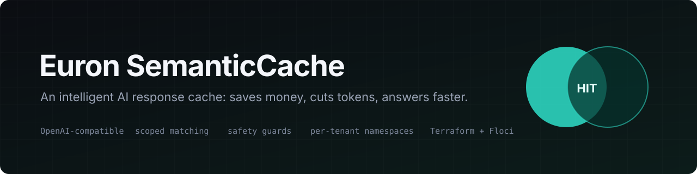
</p>

<p align="center">
  
  <a href="LICENSE"></a>
  
  
  
  
  
  
  
</p>

<p align="center">
  <a href="https://github.com/euron-sde-team/euron-semanticcache/stargazers"></a>
  <a href="https://github.com/euron-sde-team/euron-semanticcache/fork"></a>
  <a href="https://github.com/euron-sde-team/euron-semanticcache/watchers"></a>
  <br>
  <a href="https://github.com/euron-sde-team/euron-semanticcache/issues"></a>
  <a href="https://github.com/euron-sde-team/euron-semanticcache/pulls"></a>
  <a href="https://github.com/euron-sde-team/euron-semanticcache/commits/main"></a>
  
  <br>
  <a href="#built-by-the-team-behind-euron"></a>
</p>

<p align="center">
  <b><a href="#-quickstart">Quickstart</a></b> ·
  <b><a href="#️-architecture">Architecture</a></b> ·
  <b><a href="#-explore-the-repository">Explore the repo</a></b> ·
  <b><a href="#-use-it-from-your-app">Integrate</a></b> ·
  <b><a href="#️-deploy-to-aws">Deploy</a></b> ·
  <b><a href="docs/architecture/security.md">Security</a></b> ·
  <b><a href="#-documentation">Docs</a></b>
</p>

**Euron SemanticCache** is an open-source, MIT-licensed, intelligent AI response cache, part of the open-source
initiative of **ENGAGESPHERE TECHNOLOGY PRIVATE LIMITED**. It sits between your application and any
OpenAI-compatible LLM provider. Repeated questions, and *similar* ones, are answered from cache: **no tokens spent,
no provider latency**, with a console that shows exactly what it saved.

Change one line in your OpenAI SDK (`base_url`) and it starts working. What makes it safe to run in front of real
traffic is what it refuses to do: a cached answer is **never served across tenants, models, system prompts or
conversations**, and look-alike questions that differ in a **number, an identifier or a negation** are sent to the
provider, not answered from cache.

<p align="center">
  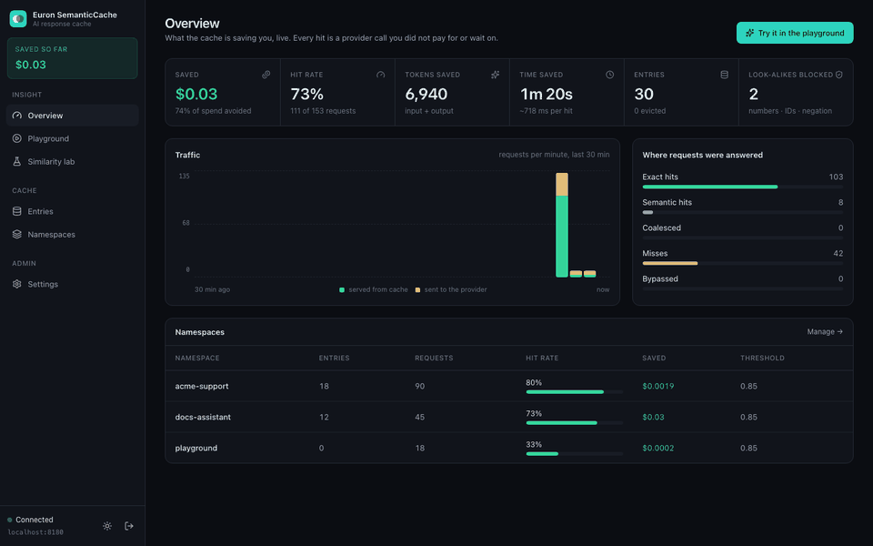
</p>

> [!NOTE]
> Everything in the tour ran for real: Docker Compose on a laptop, with S3 and Secrets Manager emulated by Floci and
> provisioned by the same Terraform modules that build production, a mock LLM provider, and **two API replicas sharing
> one cache**. `make up && make demo` reproduces it.

<h3 align="center">Built by the team behind Euron</h3>

<p align="center">Euron SemanticCache comes from the people who build these platforms. If you like how this repository is built, come and see what we build with it.</p>

<p align="center">
  <a href="https://euron.one"><picture><source media="(prefers-color-scheme: dark)" srcset="docs/assets/brand/euron-dark.svg"></picture></a>
  <a href="https://euronsystems.com"><picture><source media="(prefers-color-scheme: dark)" srcset="docs/assets/brand/euron-systems-dark.svg"></picture></a>
  <a href="https://alphaeuron.com"><picture><source media="(prefers-color-scheme: dark)" srcset="docs/assets/brand/alpha-euron-dark.svg"></picture></a>
</p>

<p align="center">
  <a href="https://www.instagram.com/euron_official"></a>
  <a href="https://www.linkedin.com/company/euronone/posts/"></a>
  <a href="https://x.com/euron712"></a>
  <a href="https://www.youtube.com/@Euron-official"></a>
  <a href="https://whatsapp.com/channel/0029VaeeJwq9RZAfPW9P2l07"></a>
</p>

---

## 📚 Table of contents

- [Why SemanticCache](#-why-semanticcache)
- [At a glance](#-at-a-glance)
- [Screenshots](#️-screenshots)
- [Features](#-features)
- [Architecture](#️-architecture)
- [Tech stack](#-tech-stack)
- [Prerequisites](#-prerequisites)
- [Quickstart](#-quickstart)
- [Use it from your app](#-use-it-from-your-app)
- [Explore the repository](#-explore-the-repository)
- [API at a glance](#-api-at-a-glance)
- [Configuration](#️-configuration)
- [Deploy to AWS](#️-deploy-to-aws)
- [Security model](#-security-model)
- [Testing](#-testing)
- [Documentation](#-documentation)
- [Roadmap](#️-roadmap)
- [FAQ](#-faq)
- [Contributing, security and license](#-contributing-security-and-license)

## 💡 Why SemanticCache

LLM applications pay for the same answers again and again: the support bot asked "how do I reset my password" in
forty wordings, the docs assistant asked the same question every morning. Each repeat costs tokens and makes a user
wait about a second. A plain cache only helps when the text matches exactly. A naive semantic cache helps more, and
quietly serves the wrong answer to "region 5" because it looked like "region 4".

| You get | Because |
| --- | --- |
| 💸 **Lower bills** | Every hit skips the provider. Savings are tracked to the micro-dollar, per namespace, from real token usage |
| ⚡ **Faster answers** | A hit is ~10 to 20 ms instead of ~700 ms or more. The playground shows both, measured in your browser |
| 🔌 **A one-line change** | OpenAI-compatible: set `base_url`. Works with the OpenAI SDKs, LiteLLM, LangChain, curl |
| 🛡️ **Safe by construction** | Matching happens only inside a scope: namespace, model, system prompt, conversation history, output format. Tested for each |
| 🔢 **No look-alike mistakes** | After similarity, numbers, identifiers (`E404`, `v2`) and negation must agree, and the console tells you which guard fired |
| 👥 **Real multi-tenancy** | A key can be bound to one namespace and then cannot read, flush, export or even name another. A fuzz test proves it |
| 💻 **One switch between laptop and cloud** | `make up` runs on an AWS emulator provisioned by the *same* Terraform modules that build production |

## 📊 At a glance

<table>
<tr>
<td align="center" width="16%"><h3>1</h3>line to adopt it<br><sub><code>base_url</code></sub></td>
<td align="center" width="16%"><h3>~15 ms</h3>per hit<br><sub>vs ~700 ms a provider call</sub></td>
<td align="center" width="16%"><h3>9</h3>Terraform modules<br><sub>3 environments</sub></td>
<td align="center" width="16%"><h3>311</h3>automated checks<br><sub>unit · integration · e2e · chaos · browser</sub></td>
<td align="center" width="16%"><h3>6</h3>architecture<br>decision records</td>
<td align="center" width="16%"><h3>0</h3>accounts or keys needed<br><sub>to run it locally</sub></td>
</tr>
</table>

## 🖼️ Screenshots

<table>
  <tr>
    <td width="50%">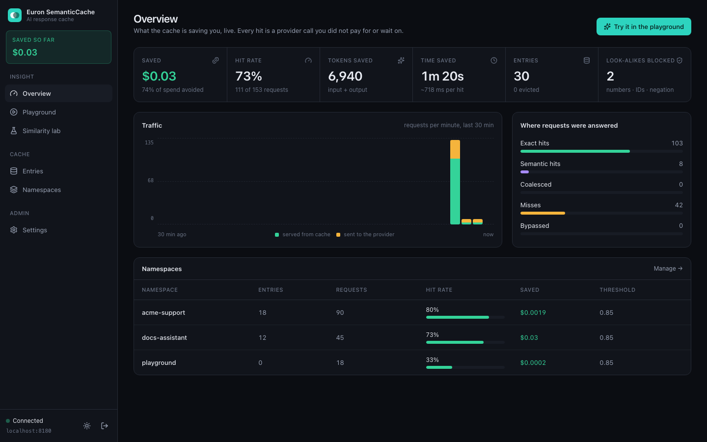<br><sub><b>Overview.</b> What the cache saved: money, tokens and time, live.</sub></td>
    <td width="50%">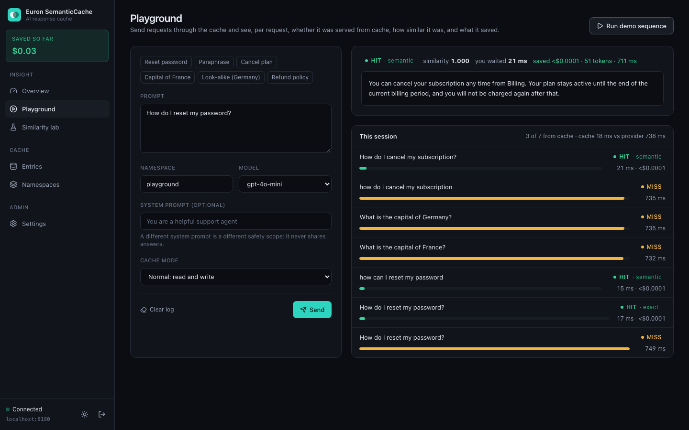<br><sub><b>Playground.</b> Every request: HIT or MISS, similarity, and what you waited.</sub></td>
  </tr>
  <tr>
    <td>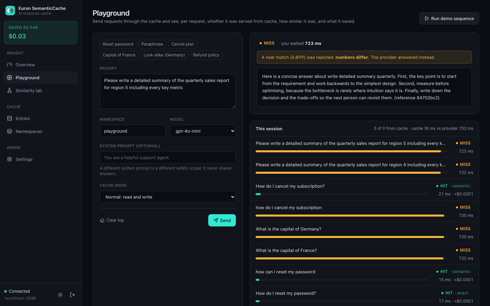<br><sub><b>Guards.</b> "Region 5" looked like "region 4" (0.899). It was refused: numbers differ.</sub></td>
    <td>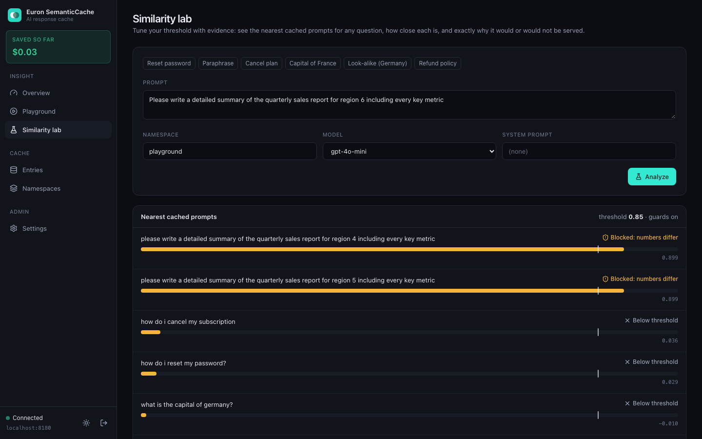<br><sub><b>Similarity lab.</b> Tune the threshold with evidence: score, scope, and the reason for each verdict.</sub></td>
  </tr>
  <tr>
    <td>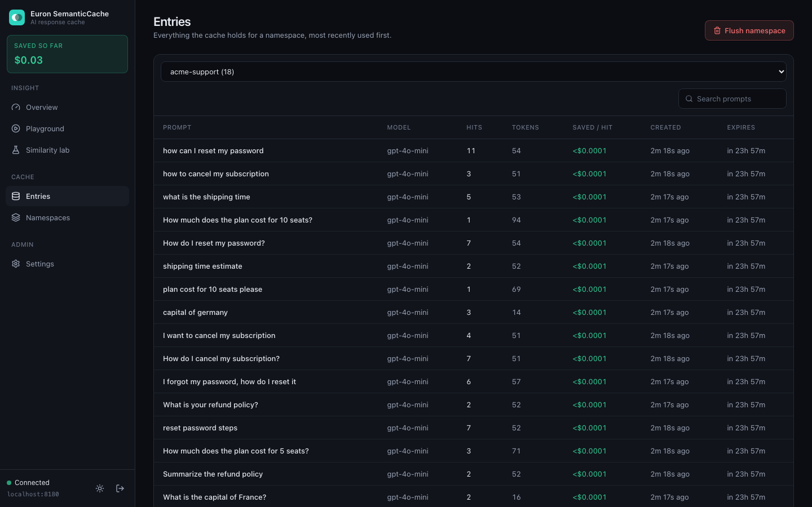<br><sub><b>Entries.</b> Search, inspect and invalidate what is cached.</sub></td>
    <td>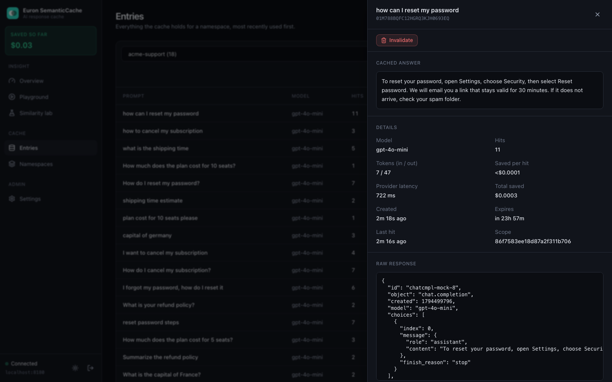<br><sub><b>Entry detail.</b> The cached answer, what it cost, what each hit saves.</sub></td>
  </tr>
  <tr>
    <td>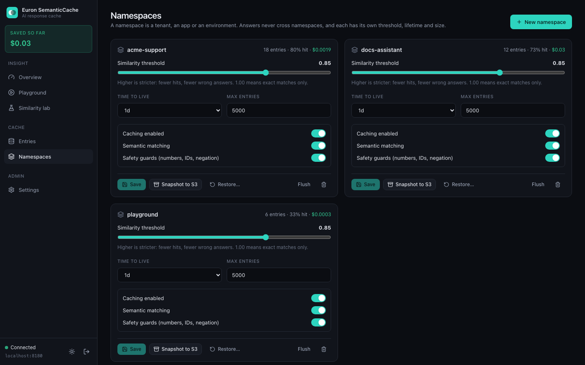<br><sub><b>Namespaces.</b> Threshold, lifetime, size and guards per tenant. Snapshot to S3.</sub></td>
    <td>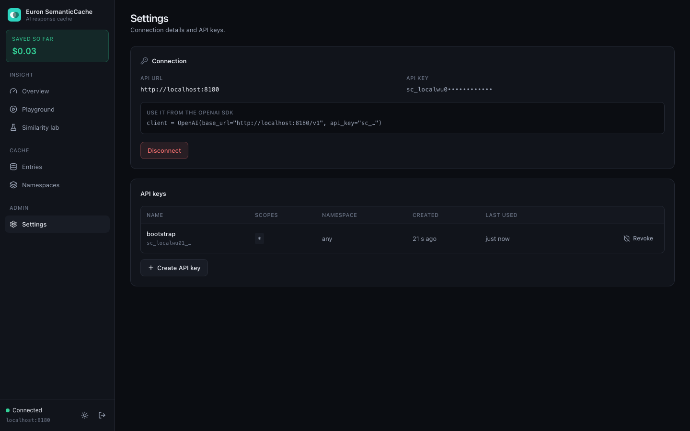<br><sub><b>API keys.</b> Scoped, and optionally bound to one namespace.</sub></td>
  </tr>
  <tr>
    <td colspan="2">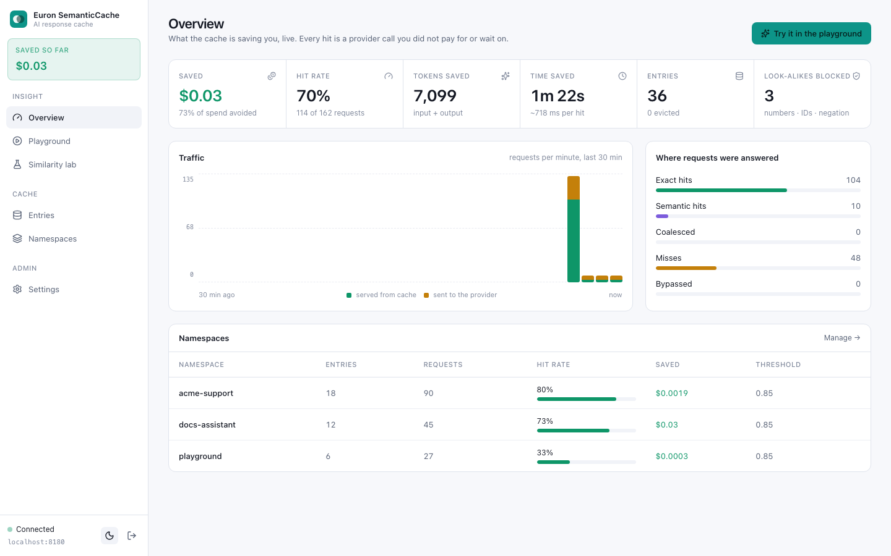<br><sub><b>Light theme.</b> Dark by default, light on request, remembered per browser.</sub></td>
  </tr>
</table>

## ✨ Features

<table>
<tr>
<td valign="top" width="50%">

#### 🧠 Matching
- **Exact and semantic lookup** inside a safety scope (model, system prompt, history, output format).
- **Deterministic guards**: numbers (`two` = `2`), identifiers, negation. Per-namespace switch.
- **Per-namespace threshold**, TTL, size cap (LRU) and on/off switches.
- **Pluggable embedders**: a dependency-free lexical one by default, any OpenAI-compatible `/embeddings` for real paraphrase matching.
- **Explainable**: `POST /v1/cache/explain` and the similarity lab show neighbours, scores and reasons.

</td>
<td valign="top" width="50%">

#### 🔌 The proxy
- **`POST /v1/chat/completions`**, OpenAI-compatible, with streaming (hits replay as an event stream).
- **Per-request control**: `X-SC-Cache: bypass | refresh | no-store | only-if-cached`, `X-SC-TTL`, `X-SC-Tags`, `X-SC-Namespace`.
- **Stampede protection**: concurrent identical misses make **one** provider call.
- **Cached only when worthwhile**: never tool calls, truncated answers, errors or empty answers.
- **Provider down?** Cached answers are still served; new questions fail cleanly with a `502`.

</td>
</tr>
<tr>
<td valign="top">

#### 💰 Accounting
- **Savings to the micro-dollar**, from real token usage and a per-model price table you can override.
- Tokens saved, **provider latency avoided**, hit rate, exact vs semantic vs coalesced, look-alikes blocked.
- Per-minute traffic series; **Prometheus `/metrics`** with savings per namespace.

</td>
<td valign="top">

#### 🧭 Operate
- **Namespaces as tenants**; keys bound to one namespace; six scopes; no privilege escalation.
- **Snapshot and restore** a namespace through S3 (re-embedded on restore, so the embedder can change).
- **Two or more API replicas** share one cache through a Redis change log; invalidations apply at once.
- Structured JSON logs, request ids, liveness and readiness probes, OpenAPI at `/docs`.
- **Console**: Next.js 15, dark and light themes, keyboard accessible, mobile layout.

</td>
</tr>
</table>

## 🏗️ Architecture

<p align="center">
  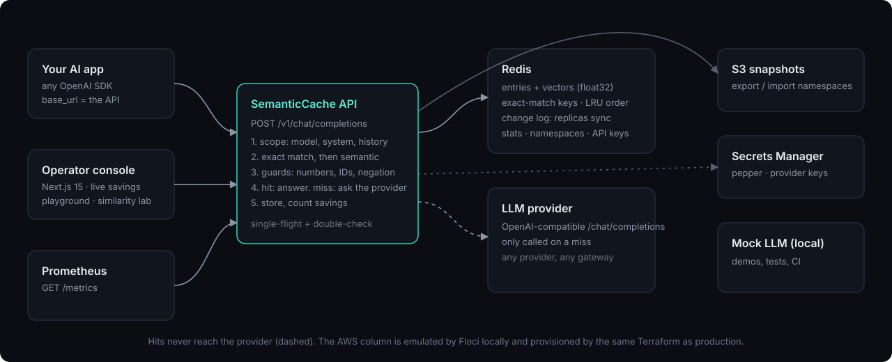
</p>

| Component | Runs as | Responsibility |
| --- | --- | --- |
| [`packages/core`](packages/core) | Python library | Text guards, embedders, the scoped vector index, Redis store with atomic Lua scripts, pricing, `SemanticCache` |
| [`apps/api`](apps/api) | FastAPI on ECS Fargate, N replicas | The caching proxy, cache management, namespaces, stats, keys, metrics |
| [`apps/mock-llm`](apps/mock-llm) | FastAPI | A deterministic provider that counts its calls: demos, tests, CI |
| [`apps/console`](apps/console) | Next.js (standalone) | Savings dashboard, playground, similarity lab, entries, namespaces |
| Redis 7 | ElastiCache (TLS, AUTH) | Entries, vectors, statistics, API keys. The only stateful part |
| S3 · Secrets Manager | Managed | Namespace snapshots; deployment secrets |

### The life of a request

<p align="center">
  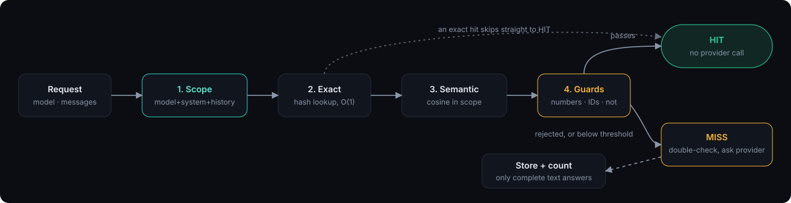
</p>

<details>
<summary><b>Sequence: a miss, a hit, and a paraphrase on the other replica</b> (click to expand)</summary>

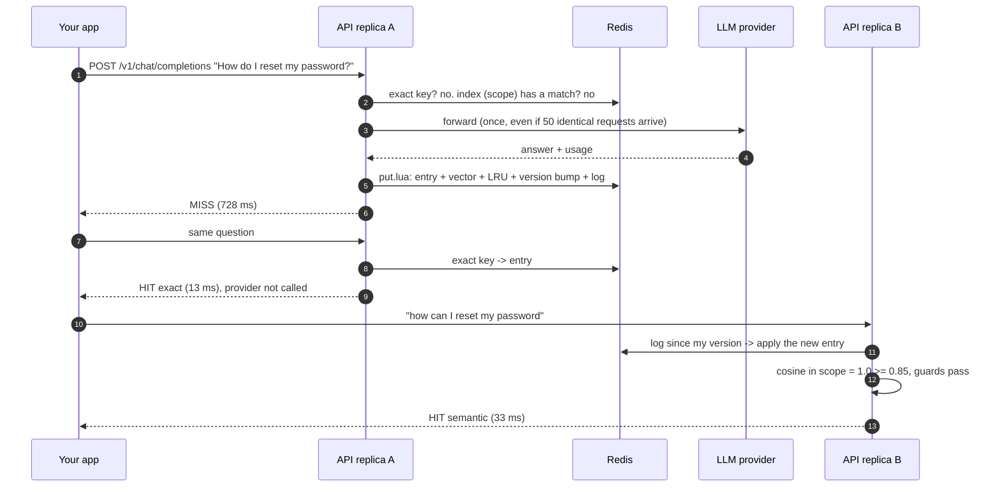
</details>

<details>
<summary><b>Why "region 5" is not served the answer for "region 4"</b></summary>

The embedding of the two prompts has similarity 0.899, above the 0.85 threshold, so a naive semantic cache would
return the wrong report. SemanticCache then compares the sets of numbers in the two prompts: `{4}` against `{5}`.
They differ, so the candidate is rejected with the reason `numbers differ`, the provider is asked, and the answer
is stored separately. The same applies to identifiers (`E404` vs `E500`) and negation (`do` vs `don't`).
</details>

Full design: **[HLD](docs/architecture/HLD.md)** · **[LLD](docs/architecture/LLD.md)** ·
**[Security](docs/architecture/security.md)** · **[ADRs](docs/architecture/adr/README.md)**.

## 🧰 Tech stack

| Layer | Choices |
| --- | --- |
| **Language** | Python 3.12 (fully typed, `mypy --strict`, `ruff`), TypeScript (strict) |
| **API** | FastAPI, Pydantic v2, uvicorn, httpx, prometheus-client |
| **Cache** | Redis 7 (`redis-py` asyncio), atomic Lua scripts, NumPy for the vector index |
| **Frontend** | Next.js 15 (App Router), React 19, TanStack Query 5, Tailwind CSS 3, lucide |
| **AWS** | S3, Secrets Manager, ElastiCache, ECS Fargate, ALB, ECR, CloudWatch |
| **Infrastructure** | Terraform (AWS provider 6.x), Docker multi-stage images, Docker Compose |
| **Local cloud** | [Floci](https://github.com/floci-io/floci), an MIT-licensed AWS emulator |
| **Quality** | pytest, Vitest, Testing Library, Playwright (Chromium), ruff, mypy, ESLint |

## 📦 Prerequisites

| Tool | Version | Try it locally | Develop | Notes |
| --- | --- | :---: | :---: | --- |
| [Docker](https://docs.docker.com/get-docker/) with Compose v2 | 24+ | ✅ | ✅ | Runs the stack, Floci and Terraform |
| GNU `make` | any | ✅ | ✅ | |
| [Python](https://www.python.org/) | 3.12 | | ✅ | `make install` creates `.venv` |
| [Node.js](https://nodejs.org/) + pnpm | 22 / 10 | | ✅ | `corepack enable` |
| [Terraform](https://developer.hashicorp.com/terraform/install) | 1.9+ | | optional | `make tf-validate` uses a container |

About **2 CPU cores and 3 GB of RAM** for Docker. macOS, Linux and Windows via WSL 2. **No LLM key is needed**: a mock provider ships with it.

## 🚀 Quickstart

```bash
git clone https://github.com/euron-sde-team/euron-semanticcache.git
cd euron-semanticcache

make up      # Floci + Terraform + Redis + mock LLM + 2 API replicas + console
make demo    # three tenants' worth of repeated, paraphrased and look-alike questions
```

Open **http://localhost:3100**. The console signs itself in with the local demo key.

| Service | URL |
| --- | --- |
| Console | http://localhost:3100 |
| API · interactive docs · metrics | http://localhost:8180 · `/docs` · `/metrics` (replica on :8181) |
| Mock LLM · call counter | http://localhost:8190 · `/stats` |
| AWS emulator (Floci) | http://localhost:4666 |

**See it with your own eyes:**

```bash
KEY=$(grep SC_BOOTSTRAP_API_KEY deploy/compose/.env | cut -d= -f2)
ask() { curl -s -D- -o /dev/null -X POST localhost:8180/v1/chat/completions -H "X-API-Key: $KEY" \
  -H 'Content-Type: application/json' -d "{\"model\":\"gpt-4o-mini\",\"messages\":[{\"role\":\"user\",\"content\":\"$1\"}]}" \
  -w 'time=%{time_total}s\n' | grep -i -E 'x-semanticcache(:|-type)|time='; }

ask "How do I reset my password?"     # x-semanticcache: MISS          time=0.73s
ask "How do I reset my password?"     # x-semanticcache: HIT (exact)   time=0.01s
ask "how can I reset my password"     # x-semanticcache: HIT (semantic)
curl -s localhost:8190/stats          # {"calls":1,...}   three requests, one provider call
```

<details>
<summary><b>What <code>make up</code> does, step by step</b></summary>

1. `make env` writes `deploy/compose/.env` with random, local-only secrets.
2. Starts **Floci**, and applies **the same Terraform used for AWS** (`infra/terraform/envs/local-floci`) to it: an S3
   exports bucket and a Secrets Manager secret.
3. Starts **Redis** (AOF, `noeviction`) and the **mock LLM provider**.
4. Starts **two API replicas** (the API reads its pepper and keys from Secrets Manager) and the **console**.
</details>

**Prove the whole chain works:**

```bash
make e2e
```

```text
the cache path: provider-call counts are the proof
  PASS first request is a MISS answered by the provider
  PASS repeat is an exact HIT
  PASS a hit is more than 10x faster than the provider
  PASS a paraphrase is a semantic HIT
  PASS the provider was called exactly once for 3 requests
safety: look-alikes and scopes never share an answer
  PASS a different number is a MISS, with the reason
  ...
e2e: all assertions passed
```

<details>
<summary><b>Everyday commands</b></summary>

| Command | Does |
| --- | --- |
| `make up` / `make down` | Start / stop the local stack (`down` deletes volumes) |
| `make logs SERVICE=api` | Tail one service |
| `make key NAMESPACE=acme` | Create an API key, optionally bound to one tenant |
| `make demo` | Seed realistic traffic |
| `make test` · `make test-console` | Python and console tests |
| `make e2e` · `make e2e-chaos` · `make e2e-browser` | Full-stack assertions · failure injection · Chromium QA |
| `make lint` · `make typecheck` · `make build` | Quality gates |
| `make tf-fmt` · `make tf-validate` | Terraform hygiene, no credentials needed |
| `make screenshots` | Regenerate the images in this README |
</details>

## 🔌 Use it from your app

```python
from openai import OpenAI

client = OpenAI(base_url="http://localhost:8180/v1", api_key="sc_...")      # the only change

resp = client.chat.completions.create(
    model="gpt-4o-mini",
    messages=[{"role": "user", "content": "How do I reset my password?"}],
    extra_headers={"X-SC-Namespace": "acme-support"},                       # one namespace per tenant
)
print(resp.semantic_cache)   # {"hit": True, "type": "semantic", "similarity": 1.0, "saved_usd": 0.000029, ...}
```

| Header | Effect |
| --- | --- |
| `X-SC-Namespace` | Which tenant's cache |
| `X-SC-Cache: bypass` | Skip the cache entirely (personalised or sensitive prompts) |
| `X-SC-Cache: refresh` | Re-ask the provider and replace the entry |
| `X-SC-Cache: only-if-cached` | Never call the provider: a miss is a `504` |
| `X-SC-TTL`, `X-SC-Tags` | Entry lifetime; tags for invalidation |

Replies carry `X-SemanticCache: HIT | MISS | COALESCED | BYPASS`, the match type, similarity and the dollars saved.
More in [Integrate your application](docs/guides/integrate.md) and [Tuning the threshold](docs/guides/tuning.md).

## 🧭 Explore the repository

**New here? Follow one request through the code in about 15 minutes.** Each step is one file:

| # | Read | You'll learn |
| :-: | --- | --- |
| 1 | [`packages/core/semanticcache_core/models.py`](packages/core/semanticcache_core/models.py) | The safety *scope*: what must be identical for an answer to be reusable |
| 2 | [`semanticcache_core/text.py`](packages/core/semanticcache_core/text.py) | The guards: numbers, identifiers, negation |
| 3 | [`semanticcache_core/embedding.py`](packages/core/semanticcache_core/embedding.py) | The default lexical embedder and the OpenAI-compatible one |
| 4 | [`semanticcache_core/scripts.py`](packages/core/semanticcache_core/scripts.py) | Atomic put, LRU eviction and the change log |
| 5 | [`semanticcache_core/index.py`](packages/core/semanticcache_core/index.py) | The in-memory vector index and how replicas sync |
| 6 | [`semanticcache_core/cache.py`](packages/core/semanticcache_core/cache.py) | Lookup, guards, store, explain, single-flight |
| 7 | [`apps/api/semanticcache_api/routers/proxy.py`](apps/api/semanticcache_api/routers/proxy.py) | The proxy: modes, double-check, streaming replay |
| 8 | [`packages/core/tests/test_cache.py`](packages/core/tests/test_cache.py) | The behaviour, as executable examples (isolation, guards, eviction) |
| 9 | [`infra/terraform/envs/local-floci`](infra/terraform/envs/local-floci/main.tf) | How the same modules run on the emulator |

```text
euron-semanticcache/
├── apps/
│   ├── api/          FastAPI: the caching proxy and control plane
│   ├── mock-llm/     deterministic OpenAI-compatible provider that counts its calls
│   └── console/      Next.js operator UI
├── packages/core/    guards, embedders, vector index, Redis store, SemanticCache
├── infra/
│   ├── terraform/    9 modules · envs: local-floci, aws-dev, aws-prod
│   └── docker/       api, mock-llm and console images
├── deploy/compose/   Compose stack (2 API replicas) + Floci overlay
├── e2e/              Playwright browser QA and the screenshot generator
├── scripts/          demo seeder, full-stack e2e, chaos e2e, OpenAPI export
└── docs/             architecture, ADRs, guides, API spec, assets
```

## 🔗 API at a glance

Interactive reference at `/docs`; the full spec is [`docs/api/openapi.yaml`](docs/api/openapi.yaml).

| Method and path | Scope | Purpose |
| --- | --- | --- |
| `POST /v1/chat/completions` | `proxy:use` | The OpenAI-compatible caching proxy (JSON and SSE) |
| `POST /v1/cache/lookup` · `/explain` | `cache:read` | Would this hit? · nearest prompts with the verdict and reason for each |
| `POST /v1/cache/entries` | `cache:write` | Warm the cache with a known answer |
| `GET /v1/cache/entries` · `/{id}` | `cache:read` | Browse and search |
| `DELETE /v1/cache/entries[/{id}]` · `POST /v1/cache/invalidate` | `cache:write` | Flush, delete one, invalidate by tag |
| `POST /v1/cache/export` · `GET /exports` · `POST /import` | `cache:read` / `cache:write` | Snapshot a namespace to S3 and restore it |
| `GET /v1/namespaces` · `PUT/DELETE /v1/namespaces/{name}` | `stats:read` / `namespaces:write` | Tenants and their settings |
| `GET /v1/stats/overview` | `stats:read` | Savings, hit rate and a per-minute series |
| `GET/POST/DELETE /v1/api-keys` | `keys:admin` | Scoped, optionally namespace-bound keys |
| `GET /healthz` · `/readyz` · `/metrics` | none | Probes and Prometheus |

## ⚙️ Configuration

Environment variables with the `SC_` prefix. The most important:

| Variable | Default | Meaning |
| --- | --- | --- |
| `SC_REDIS_URL` | `redis://localhost:6379/0` | `rediss://` for ElastiCache |
| `SC_UPSTREAM_BASE_URL` · `SC_UPSTREAM_API_KEY` | mock provider · unset | Where misses go: any OpenAI-compatible provider |
| `SC_EMBEDDER` | `hashing` | `openai` for real paraphrase matching |
| `SC_API_KEY_PEPPER` | dev placeholder | **Set a long random value** |
| `SC_CORS_ORIGINS` | `http://localhost:3100` | Console origins |
| `SC_SECRETS_ARN` | unset | Load pepper and provider keys from Secrets Manager |
| `SC_EXPORT_BUCKET` | unset | Enables snapshots |

Per namespace: `threshold` (0.85), `ttl_seconds` (1 day), `max_entries` (5000), `enabled`, `semantic`, `guards`.
Full table: [docs/guides/configuration.md](docs/guides/configuration.md).

## ☁️ Deploy to AWS

```bash
cd infra/terraform/envs/aws-dev
cp backend.tf.example backend.tf && cp terraform.tfvars.example terraform.tfvars
export TF_VAR_upstream_api_key=sk-...
terraform init && terraform apply -target=module.ecr     # registries, then push the two images
terraform apply                                          # VPC, Redis, ALB, ECS, alarms
```

| Module | Provisions |
| --- | --- |
| `network` | VPC, public and private subnets, NAT |
| `redis` | ElastiCache replication group: private, TLS, AUTH, encrypted, `noeviction`; URL in Secrets Manager |
| `ecs-service` | Fargate service, IAM roles, logs, CPU autoscaling (API and console) |
| `alb` | Load balancer, target groups, path routing, optional HTTPS |
| `storage` · `secrets` · `notifications` · `ecr` | S3 exports bucket, generated and provider secrets, alarm topic, registries |
| `observability` | CloudWatch dashboard and alarms (5xx, API CPU, Redis memory) |

Guide: [docs/guides/deploy-aws.md](docs/guides/deploy-aws.md). All three environments pass `terraform validate`, and the
`local-floci` environment is applied for real on every `make up`. The AWS environments have **not** been applied to a
live account by this repository's own tests.

## 🔒 Security model

- **Tenant isolation**: namespace-bound keys are confined to their namespace on every endpoint. A fuzz test with five
  tenants asking identical questions asserts zero cross-tenant answers.
- **Scope isolation**: no hit across model, system prompt, conversation history or output format.
- **Keys** are stored only as a peppered HMAC; a key cannot grant scopes it lacks or revoke itself.
- **Cached text is rendered as text**, never HTML (XSS tested). Hostile input is always a 2xx or 4xx, never a 5xx.
- **Redis** in private subnets with TLS and AUTH. Prompts and answers are stored verbatim, so do not cache secrets.

Details and operator checklist: [docs/architecture/security.md](docs/architecture/security.md) · [SECURITY.md](SECURITY.md).

## ✅ Testing

This project is not productionised, and every test below was written and run by Claude Code.

| Layer | Count | Proves |
| --- | ---: | --- |
| Core (real Redis) | 58 | Guards, embedders, **scoped isolation**, TTL, LRU, replica sync, accounting |
| API (real Redis) | 65 | The proxy with the provider-call count as proof, modes, streaming, **tenant isolation**, S3 export/import, Redis-restart recovery |
| Mock provider | 8 | The provider the other layers rely on |
| Console | 39 | Formatters, API client, components |
| Full-stack e2e | 59 | Real containers: one provider call for three requests, **two replicas share a cache**, S3 round trip on Floci, **secrets read from Secrets Manager** |
| Chaos e2e | 57 | 400 concurrent requests, a downed provider, SIGKILL, Redis restart, eviction and flush under load, a 5-tenant leak fuzz, hostile input |
| Browser QA (Chromium) | 25 | Every page, a real API outage and recovery, a read-only key, a namespace-bound key, XSS |
| Terraform | 3 | `validate` for every environment |

The chaos suite found two real bugs that unit tests could not: stale Redis connections after a restart became 500s
(8 of 15 requests), and a check-then-act race that paid the provider twice for one question (2 of 15 runs; 0 of 15
after the fix). Browser QA found a layout bug and a misleading error state. See
[docs/guides/testing.md](docs/guides/testing.md).

## 📖 Documentation

| Doc | |
| --- | --- |
| [Quickstart](docs/guides/quickstart-local.md) | Run it locally |
| [Integrate your application](docs/guides/integrate.md) | SDKs, headers, what is cached |
| [Tuning the threshold](docs/guides/tuning.md) | Choose a threshold with evidence |
| [Configuration](docs/guides/configuration.md) | Every variable and namespace setting |
| [Testing](docs/guides/testing.md) | The test layers and the bugs they found |
| [Deploy to AWS](docs/guides/deploy-aws.md) | Terraform walk-through |
| [Operations](docs/guides/operations.md) | Monitoring and troubleshooting |
| [HLD](docs/architecture/HLD.md) · [LLD](docs/architecture/LLD.md) · [ADRs](docs/architecture/adr/README.md) | Design |
| [OpenAPI](docs/api/openapi.yaml) | API specification |

## 🗺️ Roadmap

- [ ] **Embedding-model benchmarks** and recommended thresholds per model
- [ ] **A cross-replica single-flight** so two replicas never both ask the provider for a new question
- [ ] **Real streaming on a miss** (tee the provider's stream into the cache)
- [ ] **PII redaction** before storage, and per-namespace opt-out of storing prompts
- [ ] **Anthropic and Gemini native protocols** alongside the OpenAI-compatible one
- [ ] **Re-embed a namespace** in place when the embedder changes
- [ ] **Redis Cluster support** by hash-tagging each namespace
- [ ] **Applying the AWS Terraform environments in CI** against a sandbox account

Have an idea? [Open a feature request](https://github.com/euron-sde-team/euron-semanticcache/issues/new/choose).

## ❓ FAQ

<details>
<summary><b>Will it ever serve a wrong answer?</b></summary>

It cannot serve an answer across a scope boundary (tenant, model, system prompt, history), and the guards stop the
most common look-alike mistakes. Within one scope, similarity is still approximate: a question with the same words
but a different intent can score high. Tune the threshold with the similarity lab, keep guards on, and use
`X-SC-Cache: bypass` for prompts that must never be reused.
</details>

<details>
<summary><b>The default embedder is not a neural model. Is that a problem?</b></summary>

It matches wording (casing, stop-words, word order, typos in wording), and a loose paraphrase can miss. That is a
missed saving, never a wrong answer. Set `SC_EMBEDDER=openai` to use any `/embeddings` endpoint for real paraphrase
matching. See [ADR-0004](docs/architecture/adr/0004-pluggable-embedders-lexical-by-default.md).
</details>

<details>
<summary><b>Does it work with Anthropic, Gemini, Ollama, vLLM?</b></summary>

Anything exposing an OpenAI-compatible `/chat/completions` (LiteLLM, vLLM, Ollama and most gateways do). Native
Anthropic and Gemini protocols are on the roadmap.
</details>

<details>
<summary><b>What happens when the provider is down?</b></summary>

Cached answers keep being served. A new question returns `502 upstream_unreachable`, which is not cached. The chaos
suite stops the provider and asserts exactly this.
</details>

<details>
<summary><b>How big can a namespace be?</b></summary>

Each API process holds a namespace's vectors in memory: about `entries x 512 x 4` bytes (100k entries is roughly
200 MB). `max_entries` bounds it with LRU eviction. See [ADR-0003](docs/architecture/adr/0003-redis-store-with-an-in-memory-vector-index.md).
</details>

<details>
<summary><b>Is it production-ready?</b></summary>

It is built with production habits (atomic mutations, tenant isolation tests, TLS, scoped keys, alarms, failure
injection), but it is a showcase project and has not carried real production traffic. Read the
[security model](docs/architecture/security.md) and test against your own workload first.
</details>

## 🤝 Contributing, security and license

- **Contributing:** [CONTRIBUTING.md](CONTRIBUTING.md). Run `make lint typecheck test` first.
- **Security:** report privately, see [SECURITY.md](SECURITY.md).
- **Conduct:** [CODE_OF_CONDUCT.md](CODE_OF_CONDUCT.md).
- **License:** [MIT](LICENSE) © ENGAGESPHERE TECHNOLOGY PRIVATE LIMITED and the Euron SemanticCache contributors.
