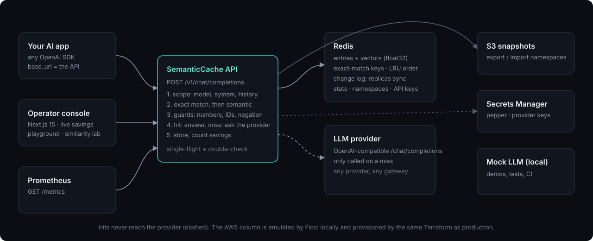
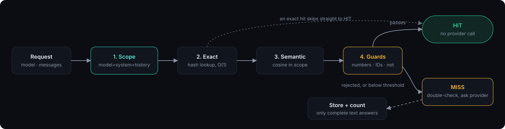

# High-level design

Euron SemanticCache sits between your application and an LLM provider. It speaks the OpenAI chat-completions
protocol, so adopting it is a one-line change: point the SDK's `base_url` at it. Repeated questions are answered
from cache, and so are similar ones, **provided it is provably safe to reuse the answer**.

## Components

| Component | Path | Runs as | Responsibility |
| --- | --- | --- | --- |
| Core library | `packages/core` | Python package | Text guards, embedders, the scoped vector index, the Redis store and Lua scripts, pricing, `SemanticCache` |
| API | `apps/api` | FastAPI on uvicorn, N replicas | The caching proxy, cache management, namespaces, stats, API keys, metrics |
| Mock LLM | `apps/mock-llm` | FastAPI | A deterministic provider that counts its calls: demos, tests and CI |
| Console | `apps/console` | Next.js 15 (standalone) | Savings dashboard, playground, similarity lab, entries, namespaces |
| Redis | ElastiCache / container | Single primary (+replicas) | Everything stateful: entries, vectors, statistics, API keys |
| S3 · Secrets Manager | AWS (Floci locally) | Managed | Cache snapshots; deployment secrets |

## One request

1. **Scope.** From the request derive a *scope*: model, system prompts, the conversation before the final question,
   output format (`response_format`, `tools`, `max_tokens`). Nothing is ever matched across scopes.
2. **Exact.** A hash of scope and the normalised final question: O(1), similarity 1.0.
3. **Semantic.** Embed the question and search the namespace's in-memory vectors, restricted to the scope. Take
   candidates above the namespace threshold.
4. **Guards.** A candidate must still agree on every number, every identifier (`E404`, `v2`) and on negation.
   Embeddings put "region 4" and "region 5" almost on top of each other; the guards do not.
5. **Hit:** return the stored answer. The provider is not called.
6. **Miss:** re-check the cache (another request may have just stored the answer), call the provider once for all
   concurrent identical requests, store complete text answers, count the cost.

## What it guarantees, and what it does not

| It guarantees | It does not |
| --- | --- |
| A cached answer is never served across namespaces, models, system prompts or conversation histories | Make semantic matching perfect. Within one scope a similar prompt can still have a different right answer: tune the threshold with the similarity lab and use `X-SC-Cache: bypass` where it matters |
| Numbers, identifiers and negation must agree before a semantic hit | Understand meaning: the default embedder is lexical. Use an `openai` embedder for paraphrase-level matching |
| N concurrent identical misses make one provider call per API process | Coordinate across replicas: two replicas may each ask once |
| Truncated answers, tool calls and errors are never cached | Cache streaming at the provider: a miss is fetched whole, then replayed as a stream |
| Entries survive API restarts and Redis restarts (AOF) | Replace the provider's own moderation, accuracy or freshness |

## Scaling

- **API replicas** are stateless apart from an in-memory copy of each namespace's vectors, kept current from a
  Redis change log. Add replicas for CPU (embedding, vector search).
- **Redis** is the ceiling. One primary holds the entries; `max_entries` per namespace bounds memory.
  A search is one matrix-vector product, exact and fast at the sizes a response cache holds.
  See [ADR-0003](adr/0003-redis-store-with-an-in-memory-vector-index.md).

## Deployment

Three Terraform environments share nine modules: `local-floci` (S3 and Secrets Manager on the emulator),
`aws-dev` and `aws-prod` (VPC, ElastiCache, ALB, Fargate API and console, autoscaling, alarms, a dashboard).

See also: [LLD](LLD.md) · [Security](security.md) · [ADRs](adr/README.md)
